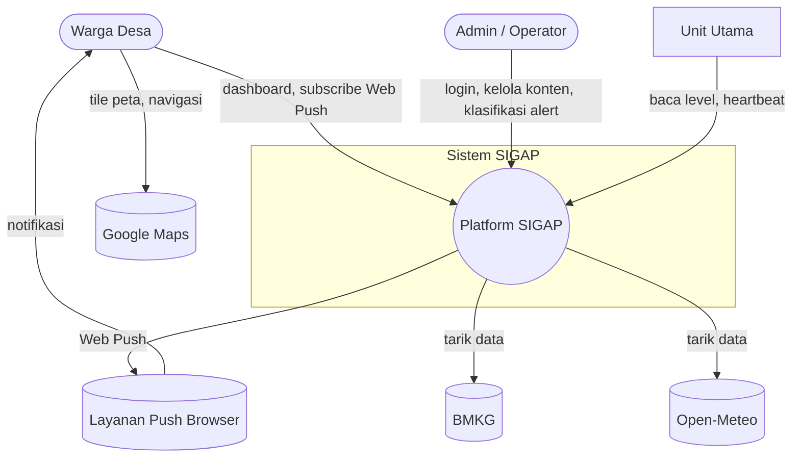

# 1. Introduction and Scope

## 1.1 Tujuan Sistem

SIGAP adalah platform monitoring lingkungan dan kesiapsiagaan bencana untuk Desa Cibenda, Kabupaten Pangandaran. SIGAP mengolah data BMKG dan Open-Meteo menjadi informasi yang mudah ditindaklanjuti, serta menyediakan gateway bagi perangkat indikator fisik. Tujuan produk dan metrik keberhasilan berada di `PRD.md`.

## 1.2 Stakeholder

| Stakeholder | Kepentingan |
|---|---|
| Warga Desa | Konsumen data publik dan penerima Web Push |
| Admin dan Operator | Pengguna API Protected untuk mengelola konten dan mengklasifikasikan alert |
| Tech Lead SIGAP | Pemilik keputusan arsitektur |
| Tim IoT | Pengelola firmware perangkat |
| Tim DevOps | Pengelola server dan deployment |

## 1.3 System Context Diagram

## 1.4 Batasan Arsitektur

- **Independent domain:** SIGAP memiliki database sendiri dan tidak berbagi database dengan sistem lain dalam program.
- **Integrasi berbasis API:** integrasi lintas sistem hanya melalui API.
- **Satu replika backend:** scheduler, rate limiter, dan cache berada di memori proses.
- **Delivery di atas kompleksitas:** implementasi yang sudah berfungsi dipertahankan selama memenuhi kebutuhan (ADR-013, ADR-027).
