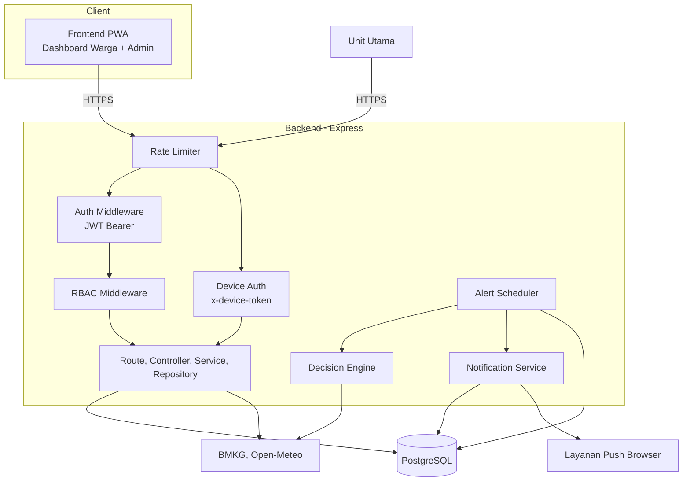

# 2. Building Block View

## 2.1 Component Diagram

## 2.2 Deskripsi Building Block

| Building Block | Tanggung Jawab | Lokasi |
|---|---|---|
| Frontend PWA | Dashboard warga dan panel admin | `apps/frontend` |
| Rate Limiter | Membatasi permintaan per IP | `middleware/rateLimit.middleware.ts` |
| Auth Middleware | Memvalidasi JWT dan daftar pencabutan token | `middleware/auth.middleware.ts` |
| RBAC Middleware | Memeriksa permission atau role dari klaim token | `middleware/rbac.middleware.ts` |
| Device Auth | Memeriksa `x-device-token` | `middleware/deviceAuth.middleware.ts` |
| Decision Engine | Menentukan level sesuai `Rules_Alerts.md` | `services/decisionEngine.service.ts` |
| Alert Scheduler | Menjalankan evaluasi berkala di dalam proses backend | `scheduler/alert.scheduler.ts` |
| Notification Service | Mengirim Web Push dan mencatat pengiriman | `services/notification.service.ts` |
| PostgreSQL | Penyimpanan data | `apps/backend/prisma/schema.prisma` |

## 2.3 Pola Lapisan Backend

Domain kontak darurat, titik evakuasi, panduan, pengguna, dan alert memakai pola route, validator, controller, service, repository. Rute `device`, `earthquakes`, `tsunami`, dan `internal` memuat handler langsung di file route. Sejumlah service mengakses Prisma tanpa repository: `alert`, `auth`, `device`, dan `notification`. Akses `earthquake_records` melalui `earthquakeRecord.repository.ts`, dan pengecekan kesehatan sistem berada di `systemHealth.service.ts`.
