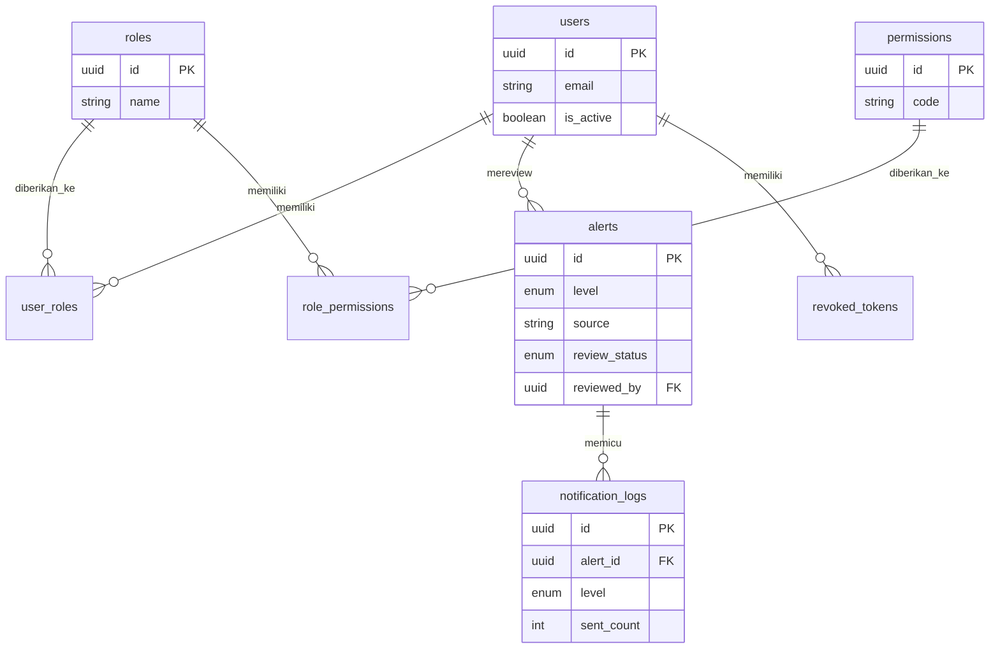

# 3. Data Architecture

Rincian kolom berada di `architecture_data_and_schema/data_dictionary/`. Sumber skema adalah `apps/backend/prisma/schema.prisma`, dengan riwayat di `apps/backend/prisma/migrations/`.

## 3.1 Entity Relationship Diagram

Tabel `devices`, `push_subscriptions`, `earthquake_records`, `emergency_contacts`, `preparedness_guides`, dan `evacuation_points` berdiri sendiri tanpa foreign key.

## 3.2 Ringkasan Domain

| Domain | Tabel | Data Dictionary |
|---|---|---|
| Users dan Auth | `users`, `revoked_tokens` | `DD_core_users.md` |
| RBAC | `roles`, `permissions`, `role_permissions`, `user_roles` | `DD_rbac.md` |
| Konten Admin | `emergency_contacts`, `preparedness_guides`, `evacuation_points` | `DD_content_admin.md` |
| Lingkungan dan Alert | `alerts`, `earthquake_records` | `DD_environmental.md` |
| Notifikasi | `push_subscriptions`, `notification_logs` | `DD_environmental.md` |
| Perangkat | `devices` | `DD_iot_kesiapsiagaan.md` |

## 3.3 Prinsip

- **Identifier:** UUID pada seluruh primary key, kecuali tabel junction RBAC yang memakai composite key.
- **Status kesiapsiagaan:** enum `AlertLevel` dengan nilai `GREEN`, `YELLOW`, `ORANGE`, `RED`. Label Bahasa Indonesia adalah pemetaan tampilan.
- **Status perangkat:** enum `DeviceStatus` dengan nilai `ONLINE`, `OFFLINE`.
- **Migrasi:** perubahan skema dilakukan melalui Prisma Migrate.
