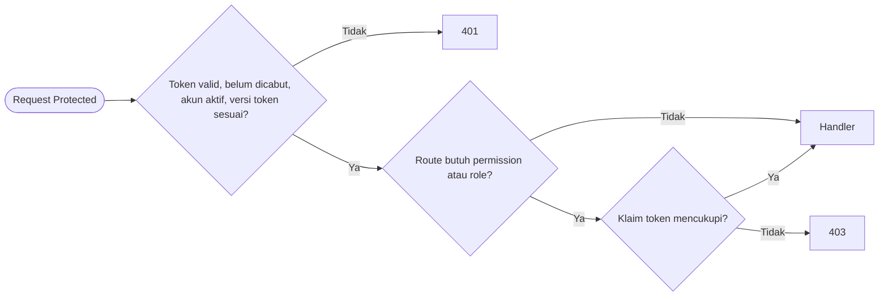

# 4. Security Architecture

## 4.1 Kategori Akses

| Kategori | Autentikasi | Contoh |
|---|---|---|
| Public | Tidak ada | `GET /api/public/alerts` |
| Protected | JWT Bearer | `POST /api/protected/users` |
| Device Gateway | Header `x-device-token` | `POST /api/public/device/heartbeat` |
| Internal | `CRON_SECRET` | `POST /api/public/internal/run-scheduler` |

Rincian tiap endpoint berada di `security_and_access_control/ROUTE_ACCESS_DESIGN.md`.

## 4.2 Alur Otorisasi

Route yang memeriksa permission adalah mutasi konten (`content.manage`), manajemen akun (`user.manage`), dan catatan tinjauan alert (`alert.validate`). Pengiriman notifikasi manual memeriksa role `admin`. Route Protected lainnya memeriksa validitas token. Struktur tabel dan seed: `DD_rbac.md`.

## 4.3 Rate Limiting

| Cakupan | Batas | Kunci |
|---|---|---|
| Umum | 300 request per menit | IP |
| Login | 15 percobaan gagal per 15 menit | IP |
| Kesehatan sistem | 60 request per menit | IP |
| Lockout login | 5 kali gagal, terkunci 15 menit | Akun |

Implementasi memakai `express-rate-limit` dengan penyimpanan memori (ADR-039).

## 4.4 Kontrol Lain

- Password disimpan sebagai hash bcrypt.
- JWT HS256 dengan `iss` dan `aud`; `JWT_SECRET` minimal 32 karakter.
- Logout mencabut `jti` token melalui `revoked_tokens`.
- Menonaktifkan akun, mengubah role, dan reset password oleh admin mencabut seluruh sesi akun melalui `users.token_version`.
- CORS memakai whitelist `ALLOWED_ORIGINS`; origin localhost hanya diizinkan di luar production.
- Header keamanan API memakai helmet; header SPA diatur Caddy.
- `TRUST_PROXY` menentukan hop proxy yang dipercaya; nilai `true` ditolak.
- Validasi environment berjalan saat startup dan gagal cepat tanpa menampilkan nilai secret.
- Endpoint subscribe menerima endpoint HTTPS pada host push gateway yang diizinkan.
- Akun awal dibuat oleh seed; di production password acak ditampilkan sekali atau diambil dari `SEED_ADMIN_PASSWORD`.

## 4.5 Envelope Error

Response error memakai `{success: false, message, errors}`. Field `errors` selalu berupa array of string.
