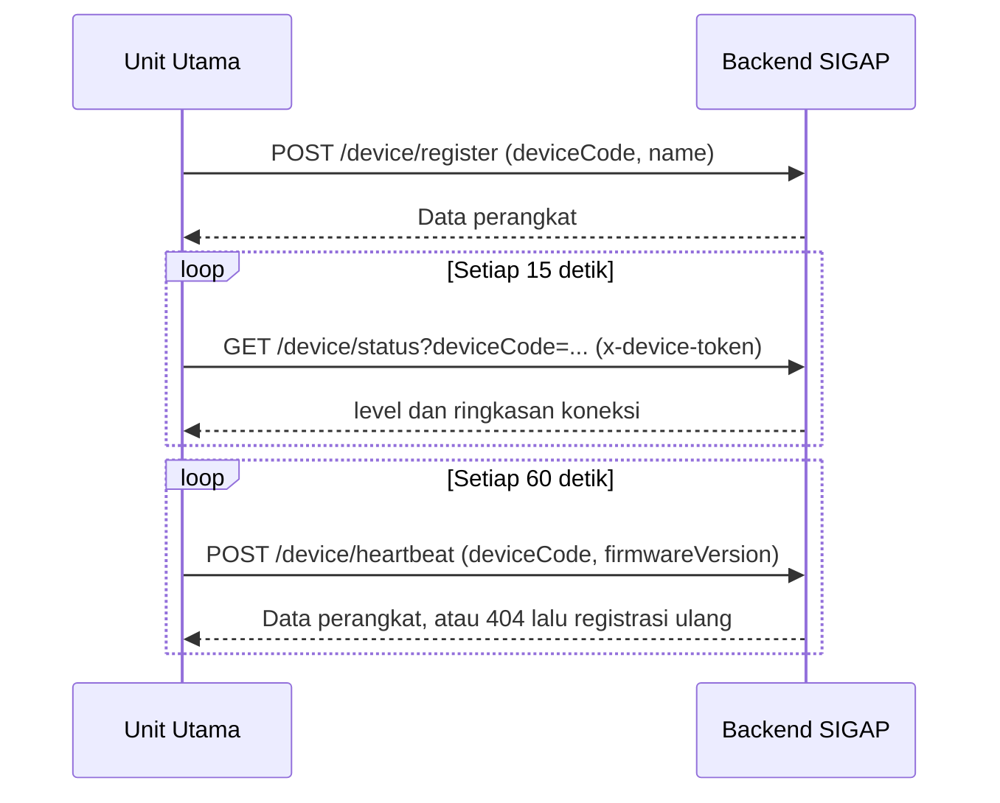

# 5. IoT Architecture

## 5.1 Ringkasan

Perangkat IoT SIGAP berfungsi sebagai penerima level kesiapsiagaan, bukan sumber data sensor. Komunikasi memakai REST polling dari perangkat ke backend (ADR-013) dengan kontrak pada ADR-052. Firmware Unit Utama (ESP32-C3) berada di `firmware/main_device/` dan dibangun dengan PlatformIO. Panduan pemasangan berada di `docs/iot-connection.md`.

## 5.2 Device Gateway

| Endpoint | Autentikasi | Fungsi |
|---|---|---|
| `GET /api/public/device/status` | Tidak ada; `x-device-token` opsional | Level alert yang berlaku dan ringkasan koneksi perangkat. Dengan `x-device-token` valid dan query `deviceCode`, panggilan dicatat sebagai laporan aktif perangkat |
| `POST /api/public/device/register` | `x-device-token` | Registrasi perangkat bila `deviceCode` belum ada; perangkat yang sudah ada diperbarui waktu lapornya tanpa mengubah nama |
| `POST /api/public/device/heartbeat` | `x-device-token` | Laporan aktif perangkat beserta `firmwareVersion`; `404` bila `deviceCode` belum terdaftar |

`x-device-token` dibandingkan dengan `DEVICE_SHARED_KEY`. Header yang dikirim dengan nilai salah ditolak `401`, termasuk pada `GET /status`.

## 5.3 Alur Komunikasi

## 5.4 Status Koneksi

| Aturan | Nilai |
|---|---|
| Perangkat aktif | Melapor (poll status, heartbeat, atau registrasi) dalam 45 detik terakhir |
| Penulisan `lastSeen` ke database | Paling sering sekali per 60 detik per perangkat; laporan di antaranya dicatat di memori backend |
| Status sistem `ONLINE` | Minimal satu perangkat aktif |
| Cache daftar perangkat | 30 detik di memori; status aktif dihitung pada setiap permintaan |

Nilai interval berada di `apps/backend/src/config/deviceRules.ts`. Setelah backend restart, status aktif memakai `lastSeen` di database sampai laporan berikutnya masuk.

## 5.5 Level

Backend memberikan salah satu dari `GREEN`, `YELLOW`, `ORANGE`, `RED`, atau `UNKNOWN`, sesuai alert yang berlaku pada `Rules_Alerts.md`. Bila pembacaan status perangkat gagal, endpoint membalas 500.

## 5.6 Firmware Unit Utama

| Aspek | Perilaku |
|---|---|
| Konfigurasi | Wi-Fi dan token perangkat di `include/secrets.h` (diabaikan git); identitas, interval, dan pin di `include/config.h` |
| Koneksi backend | HTTPS diverifikasi dengan GlobalSign Root CA R6; batas waktu koneksi dan baca masing-masing 5 detik |
| Wi-Fi | Tersambung ulang di latar belakang; perangkat restart bila Wi-Fi tidak kembali dalam 5 menit |
| Watchdog | Perangkat restart bila loop macet lebih dari 60 detik |
| Indikator | Mode "tidak diketahui" (ADR-004) sejak menyala sampai level pertama diterima, dan setelah 3 poll gagal berturut-turut atau level di luar empat level; pemetaan LED per level (ADR-015) belum diimplementasikan |
| Radio ke Sirine | nRF24L01, kanal 90, 250 kbps, PA HIGH, CRC 16 bit, auto-ACK aktif; perintah ke Sirine belum diimplementasikan |
| Sirine | Tidak pernah dibunyikan otomatis |

CI mengompilasi firmware pada job "Firmware (build)" saat `firmware/` berubah.

## 5.7 Halaman Admin

Halaman `/admin/sirine-iot` belum memiliki fungsi kontrol. Backend belum memiliki endpoint manajemen perangkat maupun trigger sirine. Desain fitur tersebut berada di `sigap-phase-2/`.
