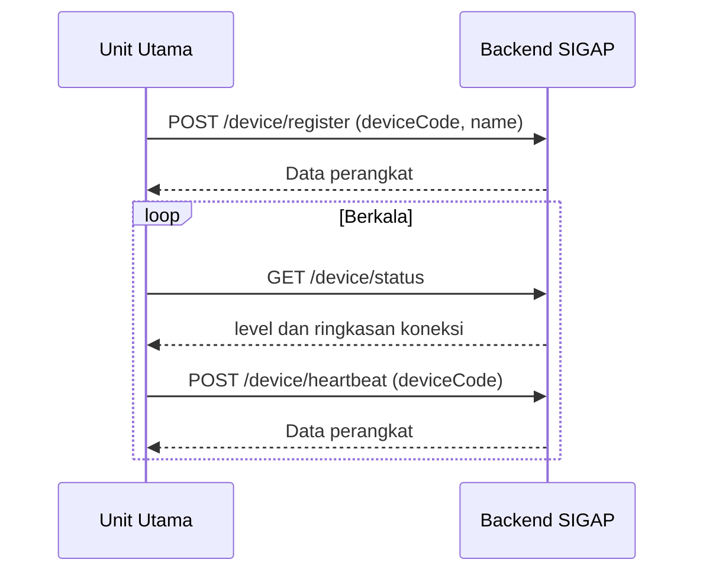

# 5. IoT Architecture

## 5.1 Ringkasan

Perangkat IoT SIGAP berfungsi sebagai penerima level kesiapsiagaan, bukan sumber data sensor. Komunikasi memakai REST polling dari perangkat ke backend (ADR-013). Firmware berada di luar repositori ini dan dikelola Tim IoT.

## 5.2 Device Gateway

| Endpoint | Autentikasi | Fungsi |
|---|---|---|
| `GET /api/public/device/status` | Tidak ada | Level alert yang berlaku dan ringkasan koneksi perangkat |
| `POST /api/public/device/register` | `x-device-token` | Registrasi perangkat bila `deviceCode` belum ada |
| `POST /api/public/device/heartbeat` | `x-device-token` | Memperbarui waktu terakhir perangkat aktif |

## 5.3 Alur Komunikasi

## 5.4 Status Koneksi

Sebuah perangkat dihitung aktif bila berstatus `ONLINE` dan melapor dalam 20 detik terakhir. Sistem berstatus `ONLINE` bila minimal satu perangkat aktif. Ringkasan disimpan dalam cache memori selama 30 detik.

## 5.5 Level

Backend memberikan salah satu dari `GREEN`, `YELLOW`, `ORANGE`, `RED`, atau `UNKNOWN`, sesuai alert yang berlaku pada `Rules_Alerts.md`. Bila pembacaan status perangkat gagal, endpoint membalas 500.

## 5.6 Halaman Admin

Halaman `/admin/sirine-iot` belum memiliki fungsi kontrol. Backend belum memiliki endpoint manajemen perangkat maupun trigger sirine. Desain fitur tersebut berada di `sigap-phase-2/`.
