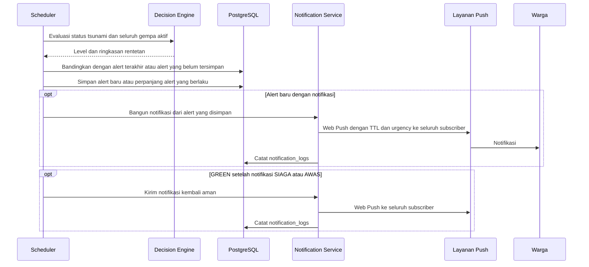
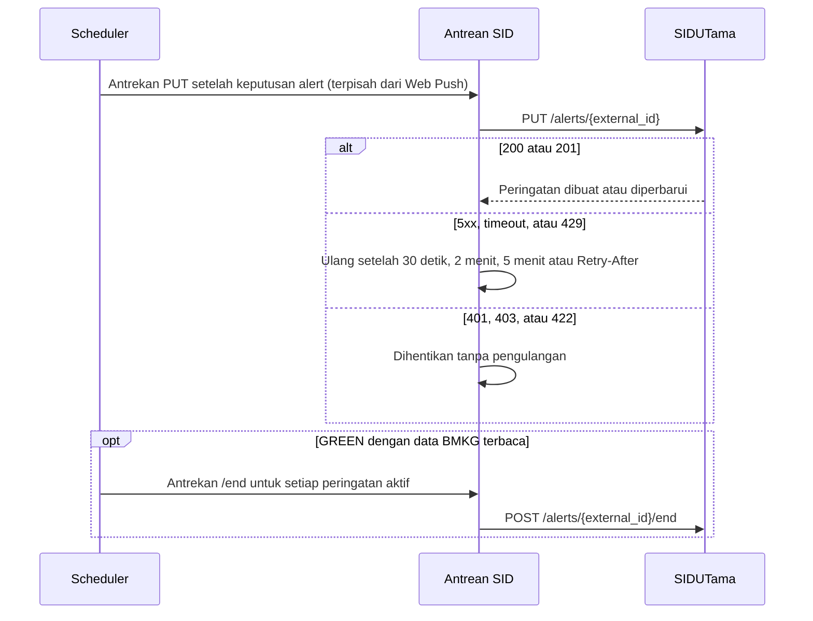

# 7. Integration Architecture

## 7.1 Integrasi yang Berjalan

| Sistem | Arah | Protokol | Fungsi |
|---|---|---|---|
| BMKG `api.bmkg.go.id` | SIGAP ke BMKG | HTTPS | Prakiraan cuaca |
| BMKG `data.bmkg.go.id` | SIGAP ke BMKG | HTTPS | Data gempa dan shakemap |
| Open-Meteo `api.open-meteo.com` | SIGAP ke Open-Meteo | HTTPS | Cuaca terkini dan prakiraan harian |
| Layanan push browser | SIGAP ke layanan push | Web Push (VAPID) | Notifikasi ke warga |
| SIDUTama `/api/integrations/v1` | SIGAP ke SID | HTTPS, Bearer token | Peringatan bencana di halaman publik dan notifikasi akun warga SID |
| Google Maps | Browser ke Google | HTTPS | Navigasi ke titik evakuasi |
| Esri Static Basemap Tiles | Browser ke Esri | HTTPS, API key | Citra satelit (opsional, hanya bila `VITE_ESRI_API_KEY` diisi) |

Permintaan ke BMKG dan Open-Meteo memakai timeout dan retry yang dapat dikonfigurasi (`HTTP_TIMEOUT_MS`, `HTTP_RETRY_COUNT`, `HTTP_RETRY_DELAY_MS`).

## 7.2 Alur Notifikasi

Notifikasi dikirim untuk alert baru pada level naik, rentetan baru, atau kenaikan magnitudo paling sedikit 1,0 pada level yang sama. Penurunan level gempa dan perpanjangan rentetan tidak mengirim notifikasi (`Rules_Alerts.md` bagian 7). Judul, gambar, TTL, urgency, notifikasi kembali aman, dan penanganan database gagal mengikuti `Rules_Alerts.md` bagian 7.2 dan 10.

## 7.3 Integrasi SID

SIGAP mengirim peringatan gempa dan tsunami ke SIDUTama mengikuti kontrak integrasi SIDUTama v1 (ADR-049). SIGAP menentukan kejadian, isi, dan siklus peringatan; SID menampilkan peringatan sebagai bar di halaman publiknya dan mengirim notifikasi ke akun warga SID.

| Endpoint SID | Fungsi |
|---|---|
| `GET /ping` | Tes koneksi dan token |
| `PUT /alerts/{external_id}` | Membuat atau memperbarui peringatan |
| `POST /alerts/{external_id}/end` | Mengakhiri peringatan; final, pembaruan berikutnya untuk id yang sama diabaikan SID |

- Autentikasi: Bearer token Sanctum milik client integrasi SIGAP dengan ability `alerts:write`, disimpan di `SID_API_TOKEN`. Batas SID 60 request per menit.
- Integrasi aktif bila `SID_INTEGRATION_ENABLED`, `SID_API_BASE_URL`, dan `SID_API_TOKEN` terisi.
- Isi, `external_id`, masa tayang, dan kapan peringatan diakhiri mengikuti `Rules_Alerts.md` bagian 10.1.
- Admin dan operator dapat memeriksa status integrasi dan isi antrean melalui `GET /api/protected/integrations/sid/status`, serta menguji koneksi melalui `POST /api/protected/integrations/sid/ping`.
- Kegagalan pengiriman ke SID tidak menghentikan siklus scheduler maupun Web Push (ADR-025).

## 7.4 Peta Dasar

Peta pada dashboard gempa, peta evakuasi warga dan admin, serta pemilih lokasi titik evakuasi memakai peta dasar self-host (ADR-051). Peta digambar di browser oleh `protomaps-leaflet` dari file PMTiles yang disajikan SIGAP sendiri, sehingga membuka peta tidak memanggil penyedia tile pihak ketiga.

| File | Cakupan | Zoom data | Dipakai oleh |
|---|---|---|---|
| `indonesia-<versi>.pmtiles` | Indonesia | 0-8 | Peta sebaran gempa |
| `pangandaran-z15-<versi>.pmtiles` | Kabupaten Pangandaran | 0-15 | Peta sebaran gempa, peta evakuasi, pemilih lokasi |

- File dibuat oleh `scripts/maps/build-basemap.sh` dari build harian Protomaps (data OpenStreetMap), diunggah sebagai aset GitHub Release `basemap-<versi>`, dan dicatat beserta sha256 pada `apps/frontend/public/maps/manifest.json`.
- Image web mengunduh file tersebut saat build lewat `scripts/maps/fetch-basemap.mjs` dan gagal bila sha256 tidak cocok. Caddy menyajikan file `.pmtiles` sebagai immutable dan mendukung range request.
- Peta evakuasi dan pemilih lokasi dibatasi ke wilayah Kabupaten Pangandaran, zoom 11-18.
- Setelah data dashboard selesai dimuat, browser menyimpan file Pangandaran utuh di cache `sigap-basemap` (sekali per versi, dilewati pada mode hemat data). Service worker melayani range request dari salinan itu, sehingga peta evakuasi tampil saat offline. Lapisan Indonesia tidak disimpan untuk offline.
- Mode satelit menampilkan citra Esri dengan label dari peta dasar di atasnya, hanya saat online; tombol Jalan/Satelit tidak tampil bila `VITE_ESRI_API_KEY` kosong.
- Atribusi: OpenStreetMap contributors dan Protomaps; Esri saat mode satelit aktif.

