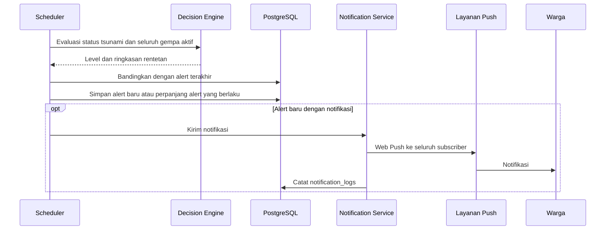

# 7. Integration Architecture

## 7.1 Integrasi yang Berjalan

| Sistem | Arah | Protokol | Fungsi |
|---|---|---|---|
| BMKG `api.bmkg.go.id` | SIGAP ke BMKG | HTTPS | Prakiraan cuaca |
| BMKG `data.bmkg.go.id` | SIGAP ke BMKG | HTTPS | Data gempa dan shakemap |
| Open-Meteo `api.open-meteo.com` | SIGAP ke Open-Meteo | HTTPS | Cuaca terkini dan prakiraan harian |
| Layanan push browser | SIGAP ke layanan push | Web Push (VAPID) | Notifikasi ke warga |
| Google Maps | Browser ke Google | HTTPS | Tile peta dan navigasi |

Permintaan ke BMKG dan Open-Meteo memakai timeout dan retry yang dapat dikonfigurasi (`HTTP_TIMEOUT_MS`, `HTTP_RETRY_COUNT`, `HTTP_RETRY_DELAY_MS`).

## 7.2 Alur Notifikasi

Notifikasi dikirim untuk alert baru pada level naik, rentetan baru, atau kenaikan magnitudo paling sedikit 1,0 pada level yang sama. Penurunan level gempa dan perpanjangan rentetan tidak mengirim notifikasi (`Rules_Alerts.md` bagian 7).

## 7.3 Integrasi SID

Integrasi dengan SID belum tersedia di kode. Halaman kesehatan sistem menampilkan entri SID berstatus `STANDBY`. Keputusan arah integrasi tercatat pada ADR-022 sampai ADR-025.
