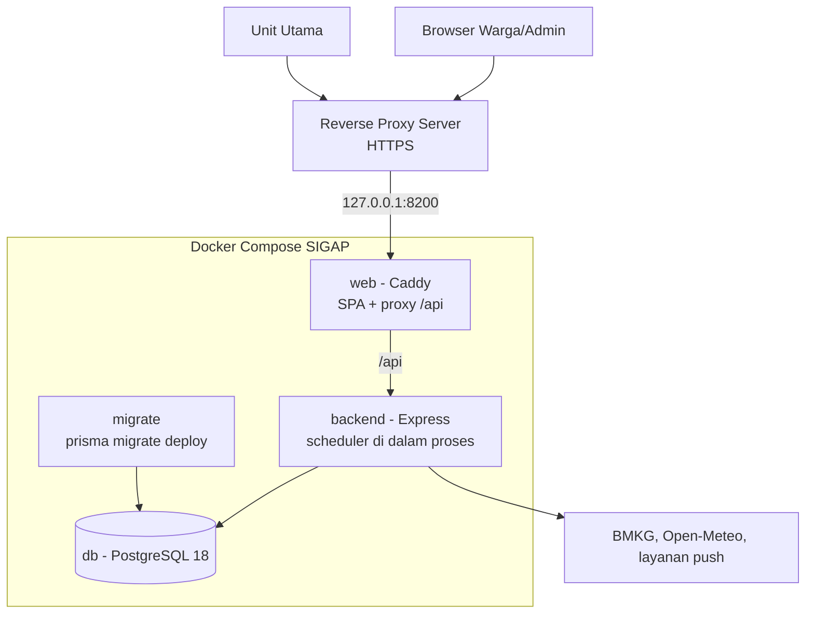

# 8. Deployment View

## 8.1 Topologi

Staging berjalan di server organisasi (Akademik Kampus) sebagai stack Docker Compose (ADR-038). HTTPS dan domain ditangani reverse proxy milik pengelola server, yang meneruskan seluruh path ke `127.0.0.1:8200`.

## 8.2 Layanan

| Service | Port | Jaringan | Fungsi |
|---|---|---|---|
| `web` | `127.0.0.1:8200` ke 80 | `egress` | Menyajikan SPA dan meneruskan `/api` |
| `backend` | 3000 (internal) | `internal`, `egress` | REST API dan scheduler |
| `db` | 5432 (internal) | `internal` | PostgreSQL 18 |
| `migrate` | - | `internal`, `egress` | Menjalankan migrasi lalu berhenti |

Backend berjalan satu replika.

## 8.3 Operasional

Seluruh operasi dijalankan lewat `deploy/sigap.sh`: deploy per tag dengan rollback otomatis bila smoke test gagal, migrasi, seed, backup dan restore, log, serta status. Rincian perintah berada di `README.md`.

## 8.4 Alur Rilis

| Branch | Fungsi |
|---|---|
| `dev` | Integrasi pengembangan |
| `release/<versi>` | Dibuat `scripts/release.sh` dari isi `dev` tanpa path pada `.release-exclude` |
| `main` | Isi rilis; versi ditandai dengan tag |

Image di-build di server dari tag rilis.

## 8.5 Migrasi Database

Skema dikelola Prisma Migrate di `apps/backend/prisma/migrations/`. `deploy/sigap.sh` mencadangkan database sebelum migrasi pada mode database lokal.

## 8.6 Environment Variables

Daftar lengkap berada di `apps/backend/.env.example` dan `deploy/sigap.env.example`. CI memeriksa kedua daftar tetap sinkron.

| Variabel | Fungsi | Wajib |
|---|---|---|
| `DATABASE_URL`, `DIRECT_URL` | Koneksi PostgreSQL | `DATABASE_URL` selalu |
| `JWT_SECRET` | Penandatanganan token, minimal 32 karakter | Selalu |
| `CRON_SECRET` | Proteksi pemicu scheduler | Selalu |
| `JWT_ISSUER`, `JWT_AUDIENCE` | Klaim token | Production |
| `DEVICE_SHARED_KEY` | Autentikasi perangkat | Production |
| `VAPID_PUBLIC_KEY`, `VAPID_PRIVATE_KEY`, `VAPID_SUBJECT` | Web Push | Production |
| `ALLOWED_ORIGINS` | Whitelist CORS | Production |
| `TRUST_PROXY` | Hop proxy yang dipercaya | Sesuai topologi |
| `ENABLE_LOCAL_SCHEDULER` | Mengaktifkan scheduler | Staging: `true` |
| `SCHEDULER_HEARTBEAT_URL` | Heartbeat ke monitoring eksternal | Opsional |

Variabel frontend: `VITE_API_BASE_URL`, `VITE_API_URL`, `VITE_ALERT_REFETCH_INTERVAL_MS`, dan `VITE_PWA_DEV`.
